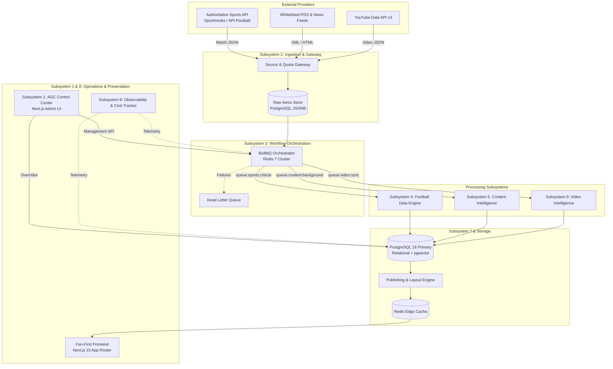

# 02 — SYSTEM ARCHITECTURE

**Project:** The Champion — It's All About MU  
**Subsystem:** Global Architecture, Modular Subsystems & Infrastructure Topology  
**Document Ref:** TC-DOC-02-SYS-ARCH  
**Authoritative Hierarchy:** Level 2 Specification  

---

## 1. High-Level Modular Architecture

The Champion is structured as a decoupled, event-driven modular architecture consisting of eight core subsystems operating over a unified relational data layer and an asynchronous message queue.

---

## 2. Eight Core Subsystems Breakdown

### 2.1 Subsystem 1: AGC Control Center UI
- **Tech Stack:** Next.js 15, Tailwind CSS, TanStack Query, shadcn/ui.
- **Responsibilities:**
  - Administrative oversight of all 11 AGC pipeline stages.
  - Manual review desk for borderline items ($0.65 \le S < 0.88$) and Tier-2 transfer rumours.
  - Configuration of source endpoints, quota alerts, and prompt template parameters.

### 2.2 Subsystem 2: Source & Quota Gateway
- **Tech Stack:** Fastify (Node.js/TypeScript), Axios with rate-limiting interceptors.
- **Responsibilities:**
  - Manages API credentials, egress rate-limits, and provider health.
  - Executes scheduled and event-triggered HTTP/RSS polling.
  - Writes incoming raw payloads immutably to `raw_items` with SHA-256 integrity hashes.

### 2.3 Subsystem 3: Workflow Orchestrator
- **Tech Stack:** BullMQ running on Redis 7.
- **Responsibilities:**
  - Manages prioritized Directed Acyclic Graphs (DAGs) across isolated queue channels.
  - Enforces exponential backoff retries, distributed Redis locking, and dead-letter routing.
  - Ensures absolute idempotency across execution cycles.

### 2.4 Subsystem 4: Football Data Engine
- **Tech Stack:** TypeScript Worker, Prisma/Kysely Query Builder.
- **Responsibilities:**
  - Normalizes external sports payloads into internal relational entities.
  - Manages real-time match state transitions (`SCHEDULED` -> `IN_PLAY` -> `FINISHED`).
  - Strict Rule: Purely deterministic execution; zero interaction with AI models.

### 2.5 Subsystem 5: Content Intelligence Engine
- **Tech Stack:** Readability, LiteLLM / Google Gemini 1.5 Flash API, pgvector.
- **Responsibilities:**
  - HTML body sanitization and boilerplate removal.
  - Named Entity Recognition (NER) and taxonomy classification.
  - Structured Indonesian translation and editorial summarization.
  - Multi-tier deduplication (MD5, MinHash, and Cosine Vector Similarity).

### 2.6 Subsystem 6: Video Intelligence Engine
- **Tech Stack:** YouTube Data API v3 Client, Node.js Worker.
- **Responsibilities:**
  - Channel upload and playlist synchronization using low-cost `playlistItems.list`.
  - Embeddability and geographic restriction verification.
  - Association of official highlight clips with authoritative `match_id` records.

### 2.7 Subsystem 7: Publishing & Dynamic Layout Engine
- **Tech Stack:** Fastify API, Redis Cache, Next.js Revalidation Engine.
- **Responsibilities:**
  - Evaluates club state context (`PRE_MATCH`, `LIVE_MATCH`, `POST_MATCH`, `NO_MATCH`).
  - Assembles unified dynamic JSON layout contracts (`/api/v1/layout/homepage`).
  - Manages Edge CDN cache tag purging on match and content events.

### 2.8 Subsystem 8: Observability & Cost Center
- **Tech Stack:** OpenTelemetry, Prometheus, Grafana, Sentry.
- **Responsibilities:**
  - End-to-end tracing across pipeline jobs.
  - Token consumption tracking (Prompt vs. Completion tokens per model).
  - Quota monitoring for Sports APIs and YouTube Data API.

---

## 3. Communication & Data Flow Topologies

| Interaction Path | Mechanism | Latency Expectation | Failure Strategy |
| :--- | :--- | :--- | :--- |
| **Gateway -> Raw Storage** | Direct DB Write | < 25 ms | Retry 3x, quarantine source on repeated HTTP error |
| **Orchestrator -> Workers** | Redis BullMQ Message | < 5 ms | Exponential backoff (1s, 5s, 15s), DLQ routing |
| **Sports Engine -> Presentation** | Postgres Relational Write | < 20 ms | Transaction rollback, stale cache serving |
| **Content Engine -> Gemini API** | HTTPS / TLS 1.3 REST | 800 - 2000 ms | Rate-limit backoff, circuit breaker on 5xx |
| **Frontend -> Layout API** | CDN-cached HTTPS GET | < 30 ms (CDN) | Serve Stale-While-Revalidate (SWR) |

---

## 4. Failure Handling & Disaster Recovery

1. **Sports Provider Outage:**
   - If the active Sports API fails during a live match, the system locks the last valid state and flags UI with an amber "Live Update Stalled" badge. If failure exceeds 3 cycles (45 seconds), traffic switches to the secondary provider endpoint.
2. **AI Service Outage:**
   - If Gemini API returns 503/429 errors, raw news items remain queued in BullMQ. Essential factual match data is unaffected.
3. **Database Failover:**
   - Managed PostgreSQL 16 cluster with automated standby failover in < 60 seconds.