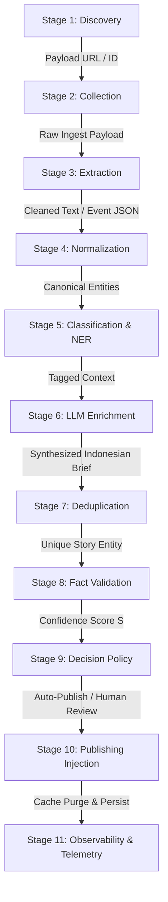

# 04 — AGC PIPELINE SPECIFICATION

**Project:** The Champion — It's All About MU  
**Subsystem:** 11-Stage Unified Automated Content Generation Pipeline  
**Document Ref:** TC-DOC-04-AGC-PIPE  
**Authoritative Hierarchy:** Level 2 Specification  

---

## 1. Unified 11-Stage Processing DAG

Every unit of information collected by The Champion executes through an 11-stage directed acyclic graph (DAG) enforced by BullMQ.

---

## 2. Stage-by-Stage Specification

### Stage 1: Discovery
- **Input Contract:** Polling scheduler trigger or external webhook event.
- **Processing Logic:** Evaluates active sources in `sources`. Checks rate-limits and last poll timestamps. Emits job to `queue:discovery`.
- **Output Contract:** `DiscoveryEvent { sourceId: UUID, targetUri: string, expectedClass: Enum }`
- **Error Handling:** Log warning on DNS/Connection failure; increment failure count in `source_health`.
- **Idempotency:** Composite key: `discovery:{sourceId}:{dateHour}`.

### Stage 2: Collection
- **Input Contract:** `DiscoveryEvent`.
- **Processing Logic:** Executes authenticated HTTP GET / RSS XML fetch / API query. Computes SHA-256 hash of response payload. Writes immutably to `raw_items`.
- **Output Contract:** `RawItemRef { rawItemId: UUID, hash: string, payload: JSONB }`
- **Error Handling:** If status == 429 (Rate Limited), back off exponentially. Quarantine source if consecutive failures > 5.

### Stage 3: Extraction
- **Input Contract:** `RawItemRef`.
- **Processing Logic:**
  - *Articles/RSS:* Uses `@mozilla/readability` to extract main text, title, author, and timestamp while discarding ads, navigation, and boilerplate.
  - *Sports API:* Extracts match fixtures, lineups, minute, and event data.
  - *YouTube:* Extracts video ID, title, description, and embed status.
- **Output Contract:** `ExtractedPayload { title: string, textContent: string, mediaUrls: string[], externalDate: ISO8601 }`

### Stage 4: Normalization
- **Input Contract:** `ExtractedPayload`.
- **Processing Logic:** Maps external third-party IDs to internal canonical identifiers. Standardizes all dates to UTC ISO-8601. Standardizes club names (e.g., "Man Utd", "Manchester United FC" -> `club_manchester_united`).
- **Output Contract:** `CanonicalItem { canonicalClubId: string, timestampUtc: string, payload: Record<string, any> }`

### Stage 5: Classification & NER
- **Input Contract:** `CanonicalItem`.
- **Processing Logic:** Runs Named Entity Recognition (NER) to isolate club players, coaches, competition, and opponent. Categorizes into taxonomy: `MATCH_REPORT`, `MATCH_PREVIEW`, `INJURY_UPDATE`, `TRANSFER_CONFIRMED`, `TRANSFER_RUMOUR`, `TACTICAL_ANALYSIS`.
- **Output Contract:** `ClassifiedItem { category: Enum, entities: { players: string[], opponent?: string } }`

### Stage 6: LLM Enrichment
- **Input Contract:** `ClassifiedItem`.
- **Strict Boundary:** Factual sports facts (scores, stats) bypass this stage. Only editorial and textual news undergo LLM processing.
- **Processing Logic:** LiteLLM / Gemini API prompt generates:
  1. Concise Indonesian editorial headline.
  2. 3-bullet core takeaway summary.
  3. Professional Indonesian body narrative (150–200 words).
  4. Extracted direct quotes with speaker attribution.
- **Temperature:** Enforced at `0.2` for factual fidelity. Structured output verified via JSON schema.
- **Output Contract:** `EnrichedContent { idHeadline: string, idSummary: string, keyPoints: string[], quotes: string[] }`

### Stage 7: Multi-Tier Deduplication
- **Input Contract:** `EnrichedContent` + `CanonicalItem`.
- **Processing Logic:**
  - *Tier 1 (Exact):* Check `content_hash` against existing records.
  - *Tier 2 (Syntactic):* MinHash / SimHash 64-bit fingerprinting (> 85% Hamming similarity merged).
  - *Tier 3 (Semantic):* Vector embedding cosine distance ($> 0.92$ similarity within rolling 36-hour window assigns item to existing `story_clusters` rather than spawning duplicate).
- **Output Contract:** `DedupResult { isDuplicate: boolean, clusterId: UUID, action: 'CREATE' | 'ATTACH' | 'DISCARD' }`

### Stage 8: Fact Validation
- **Input Contract:** `EnrichedContent` + Sports DB State.
- **Processing Logic:** Cross-references dates, player roster status, and match results mentioned in generated summaries against authoritative `matches` and `teams` database tables.
- **Confidence Formula:**
  $$S = (0.35 \times W_{\text{source}}) + (0.25 \times C_{\text{extractor}}) + (0.20 \times F_{\text{fact\_check}}) + (0.20 \times D_{\text{dedup}})$$
- **Output Contract:** `ValidationResult { confidenceScore: float, factCheckPassed: boolean, flags: string[] }`

### Stage 9: Decision Policy
- **Input Contract:** `ValidationResult` and Content Category.
- **Decision Engine Rules:**
  - If $S \ge 0.88$ AND Category $\ne$ `TRANSFER_RUMOUR` $\rightarrow$ **AUTO_PUBLISH**.
  - If Category $==$ `TRANSFER_RUMOUR` AND Source Tier $== 1$ $\rightarrow$ **AUTO_PUBLISH** (with mandatory visual `RUMOUR` badge).
  - If Category $==$ `TRANSFER_RUMOUR` AND Source Tier $> 1$ $\rightarrow$ **HOLD_FOR_REVIEW**.
  - If $0.65 \le S < 0.88$ OR `factCheckPassed == false` $\rightarrow$ **HOLD_FOR_REVIEW**.
  - If $S < 0.65$ $\rightarrow$ **REJECT_AND_LOG**.
- **Output Contract:** `DecisionResult { action: 'PUBLISH' | 'REVIEW' | 'REJECT' }`

### Stage 10: Dynamic Section Publishing
- **Input Contract:** Approved content and media entities.
- **Processing Logic:** Writes record to `published_items`. Calculates section routing (`HERO`, `TRANSFER_HUB`, `WATCH_AGAIN`, `NEWS_FEED`). Triggers Edge CDN cache purge tags: `revalidateTag('homepage')`.
- **Output Contract:** `PublishRecord { publishedItemId: UUID, sectionCode: string, cacheTags: string[] }`

### Stage 11: Observability & Telemetry
- **Input Contract:** Complete execution trace.
- **Processing Logic:** Records execution latency per stage, LLM token counts, Sports API credits expended, and emits OpenTelemetry spans to Prometheus/Grafana.
- **Output Contract:** Emitted metric record.