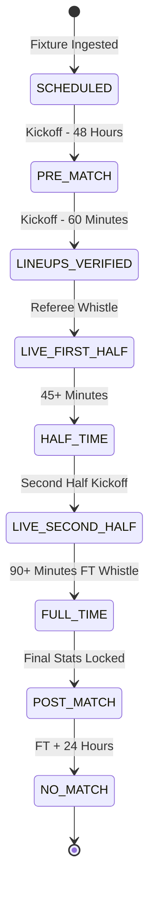

# 05 — FOOTBALL DATA ENGINE

**Project:** The Champion — It's All About MU  
**Subsystem:** Authoritative Sports Engine, Match Lifecycle & Deterministic Synchronization  
**Document Ref:** TC-DOC-05-FOOTBALL-ENG  
**Authoritative Hierarchy:** Level 2 Specification  

---

## 1. Absolute Sports Truth Mandate

> **CRITICAL ARCHITECTURAL MANDATE:**  
> Large Language Models (LLMs) are strictly forbidden from determining, updating, or generating factual football data. All match fixtures, kickoff times, live clocks, scores, disciplinary events, lineups, and league tables must originate exclusively from authoritative sports data APIs (Sportmonks API v3 or API-Football).

---

## 2. Match Lifecycle State Machine

The sports engine manages the match lifecycle state deterministically based on provider status feeds.

---

## 3. Provider Polling & Ingestion Intervals

To balance freshness with API subscription quotas, dynamic polling intervals are enforced:

| Match State Window | Polling Interval | Target Endpoints | Quota Consumption Strategy |
| :--- | :--- | :--- | :--- |
| **No-Match / Off-Season** | Every 12 Hours | `/fixtures`, `/standings`, `/squad` | Minimal daily check for fixture date shifts |
| **Pre-Match (T-48h to T-1h)** | Every 60 Minutes | `/fixtures/{id}`, `/injuries` | Verify kickoff times, venue, and broadcast details |
| **Lineup Announcement (T-60m)**| Every 2 Minutes | `/fixtures/{id}/lineups` | Lock confirmed Starting XI and bench players |
| **Live Match (0' - 90'+)** | Every 15 Seconds | `/fixtures/{id}/live-events` | Near real-time clock, goals, cards, subs, and xG |
| **Post-Match (+0m to +60m)** | Every 5 Minutes | `/fixtures/{id}/statistics` | Ingest confirmed possession, shots, and player ratings |
| **Post-Match (+1h to +24h)** | Every 60 Minutes | `/standings` | Recalculate Premier League / Cup tables |

---

## 4. API Fallback & Data Freshness Protection

1. **Deterministic Validation Checks:**
   - Scorelines can never decrease during a match unless explicitly flagged by a `VAR_OVERTURN` event.
   - Clock minutes cannot jump backwards.
   - Match status cannot transition from `FINISHED` back to `IN_PLAY`.
2. **Provider Failover Strategy:**
   - If primary provider (Sportmonks) fails to respond within 3 consecutive 15-second cycles during a live match:
     - Worker logs a `CRITICAL_PROVIDER_TIMEOUT` alert.
     - System serves cached state with an active `is_stale: true` flag.
     - Secondary backup provider (API-Football) client is initialized to resume score updates.
3. **Idempotent Match Event Ingestion:**
   - Every event (goal, card, substitution) carries an `external_event_id`. Upserts use `ON CONFLICT (external_event_id) DO UPDATE` to prevent duplicated goals on rapid polling cycles.