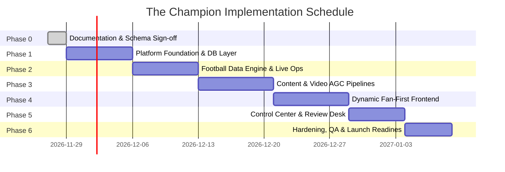

# 14 — IMPLEMENTATION ROADMAP

**Project:** The Champion — It's All About MU  
**Subsystem:** Phased Execution Architecture & Definitions of Done  
**Document Ref:** TC-DOC-14-ROADMAP  
**Authoritative Hierarchy:** Level 2 Specification  

---

## 1. Phased Execution Overview

The development of The Champion is divided into six independently testable phases. Implementation code must NOT begin until Phase 0 sign-off is granted by the Product Owner.

---

## 2. Phase Deliverables & Definition of Done

### Phase 1: Platform Foundation & Core Services
- **Deliverables:** PostgreSQL 16 schema migrations, Redis 7 BullMQ setup, Fastify API boilerplate, unified error handling.
- **Definition of Done:** Synthetic job executed through BullMQ with automatic retries and DLQ routing. Complete DDL schema verified against sample queries.

### Phase 2: Authoritative Football Data Engine
- **Deliverables:** Sportmonks client, fixture hydration job, live match clock poller, standings synchronizer.
- **Definition of Done:** Ingestion worker consumes live match stream, deterministically updates score and minute clock in < 3 seconds, with zero AI involvement.

### Phase 3: Content & Video Intelligence Pipelines
- **Deliverables:** RSS/HTML extractor, Gemini 1.5 Flash LiteLLM integration, MinHash & pgvector deduplication, YouTube playlist poller.
- **Definition of Done:** 50 test news feeds processed into Indonesian briefs; duplicates merged into single clusters; YouTube highlights correctly matched to fixtures.

### Phase 4: Dynamic Fan Frontend
- **Deliverables:** Next.js 15 App Router scaffolding, 4-state dynamic homepage engine, Live Match Center widget, responsive Tailwind CSS styling.
- **Definition of Done:** Frontend switches seamlessly between `PRE_MATCH`, `LIVE_MATCH`, `POST_MATCH`, and `NO_MATCH` based on API state; Lighthouse Performance score $> 90$.

### Phase 5: AGC Control Center & Moderation Desk
- **Deliverables:** Operational dashboard, source configuration UI, manual review queue, prompt tuning interface.
- **Definition of Done:** Operator can approve, edit, or reject pending transfer rumours and low-confidence items with changes instantly reflected on the frontend.

### Phase 6: Hardening, Security & Production Launch
- **Deliverables:** Load testing with k6 (5,000 virtual users), YouTube API quota audit, copyright attribution review, edge cache TTL tuning.
- **Definition of Done:** Zero high/critical vulnerabilities; P99 latency $< 150$ ms; zero unauthorized streaming links present.