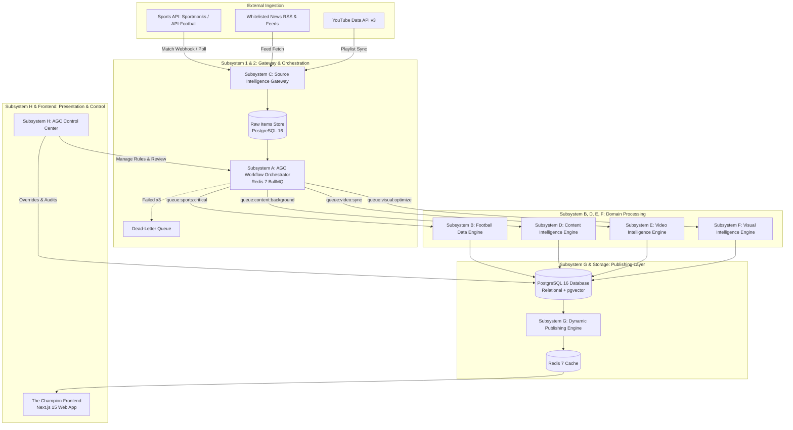

# 01 — SYSTEM ARCHITECTURE & TOPOLOGY

**Document Ref:** TC-DOC-01-SYS-ARCH  
**System:** The Champion Architecture & Layering  
**Architectural Authority:** Level 2 Structural Specification  

---

## 1. Three-Tier Architectural Layering

The Champion enforces a strict three-tier separation of concerns. The Champion consumes AGC capabilities through defined API and queue contracts, but The Champion is **NOT** the AGC Core Engine itself:

```
+---------------------------------------------------------------------------------------+
|                                LAYER 1: AGC CORE ENGINE                                |
|  - Source Polling & Discovery Daemon              - Deduplication Engine (Hash/Vector) |
|  - Multi-Modal Extractors (HTML, RSS, Media)      - Quality & Confidence Scoring ($S$) |
|  - LLM Transformation & Translation Proxy          - Workflow DAG Orchestration (BullMQ)|
+---------------------------------------------------------------------------------------+
                                           |  (Defined Job & Event Contracts)
                                           v
+---------------------------------------------------------------------------------------+
|                         LAYER 2: THE CHAMPION APPLICATION                             |
|  - Authoritative Football Data Engine             - Dynamic Homepage State Machine     |
|  - Manchester United Club Domain Logic            - Operational AGC Control Center     |
|  - Video & Visual Intelligence Linking            - Moderation Review Desk & RBAC      |
+---------------------------------------------------------------------------------------+
                                           |  (Edge-Cached Dynamic REST APIs)
                                           v
+---------------------------------------------------------------------------------------+
|                         LAYER 3: THE CHAMPION FRONTEND                                |
|  - Next.js 15 App Router (SSR / ISR)              - Responsive Fan-First UI Components |
|  - Real-Time Live Match Center Widget             - Dark Navy & Manchester Red System  |
+---------------------------------------------------------------------------------------+
```

---

## 2. Global Subsystem Topology

The system comprises eight distinct logical subsystems operating over a unified data and message layer:



---

## 3. Communication Patterns & Service Boundaries

| Interaction Path | Protocol / Mechanism | Latency Expectation | Failure Strategy |
| :--- | :--- | :--- | :--- |
| **Ingestion Gateway -> Raw Store** | SQL Connection Pool (pg) | < 25 ms | Retry 3x with backoff; log failure |
| **Gateway -> BullMQ Orchestrator** | Redis Job Push (`rpush`) | < 5 ms | In-memory buffer; alert on connection break |
| **Orchestrator -> Pipeline Workers** | Redis Consumer (`brpoplpush`) | < 10 ms | Exponential backoff (1s, 5s, 15s); route to DLQ |
| **Football Engine -> Sports APIs** | HTTPS REST / WebSockets | < 500 ms | Serve stale cache; failover to secondary provider |
| **Content Engine -> LLM Gateway** | HTTPS REST (LiteLLM / Gemini) | 800 - 2,500 ms | Circuit breaker on 429/5xx; retry queued job |
| **Dynamic Publisher -> Edge Cache** | Redis Invalidation / `revalidateTag` | < 15 ms | Fallback to origin database read |
| **Frontend -> Layout API** | HTTPS JSON / CDN Cached | < 50 ms (Edge) | Stale-While-Revalidate (SWR) |

---

## 4. Failure Handling & Disaster Recovery

1. **External Sports API Outage During Live Match:**
   - The system freezes the last verified match state, flags the UI with `is_stale: true`, and switches to the secondary provider endpoint if 3 consecutive polls fail.
2. **LLM Provider Outage or Rate Limit:**
   - Text summarization jobs accumulate in `queue:content:background`. Factual sports data, match clocks, and video ingestion remain 100% operational.
3. **Database Connectivity Degradation:**
   - Redis Edge cache serves cached layout contracts (`/api/v1/layout/homepage`) with an extended TTL of 10 minutes while connection pools re-establish.