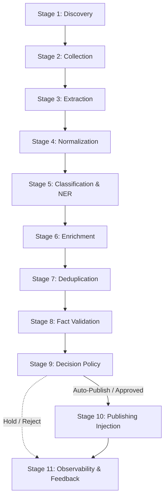

# 03 — AUTOMATION PIPELINE SPECIFICATION

**Document Ref:** TC-DOC-03-PIPELINE  
**System:** 11-Stage Unified Automated Content Generation DAG  
**Architectural Authority:** Level 2 Process Blueprint  

---

## 1. Unified 11-Stage Lifecycle Overview

Every unit of information collected by The Champion executes through an 11-stage directed acyclic graph (DAG):

---

## 2. Stage-by-Stage Specifications

### Stage 1: Discovery
- **Purpose:** Identifies pending polling tasks and external webhook triggers.
- **Input:** Scheduler cron tick or external webhook notification.
- **Processing:** Checks `sources` table for active feeds due for synchronization based on `polling_frequency_seconds`.
- **Output:** `DiscoveryJob { sourceId, targetUrl, sourceType }`
- **Dependencies:** Subsystem C (Source Intelligence).
- **Failure Handling:** Log warning, increment consecutive failure counter in `source_health`.
- **Retry Strategy:** Fixed interval retry on next cron tick.
- **Status Transitions:** `IDLE` -> `DISCOVERED`.

### Stage 2: Collection
- **Purpose:** Ingests raw payload from the external source over HTTPS.
- **Input:** `DiscoveryJob`.
- **Processing:** Performs authenticated GET request; computes SHA-256 hash of response body; inserts immutably into `raw_items`.
- **Output:** `RawItemRef { rawItemId, contentHash, payload }`
- **Dependencies:** External network, Subsystem C.
- **Failure Handling:** If HTTP status is 429, back off exponentially. Quarantine source if consecutive failures > 5.
- **Retry Strategy:** 3 retries with exponential backoff (1s, 5s, 15s).
- **Status Transitions:** `DISCOVERED` -> `COLLECTED` (or `FAILED_COLLECTION`).

### Stage 3: Extraction
- **Purpose:** Extracts structured fields from raw HTML, RSS XML, or JSON feeds.
- **Input:** `RawItemRef`.
- **Processing:** For HTML/RSS: runs `@mozilla/readability` to isolate clean title, body, author, and publication timestamp. For Sports/Video: parses structured API fields.
- **Output:** `ExtractedArticle { title, rawText, author, publishedAt, mediaUrls }`
- **Dependencies:** Subsystem D (Content Intelligence).
- **Failure Handling:** If extraction produces < 50 words of body text, mark item as `UNPARSEABLE`.
- **Retry Strategy:** Non-retryable if payload is malformed.
- **Status Transitions:** `COLLECTED` -> `EXTRACTED` (or `DISCARDED`).

### Stage 4: Normalization
- **Purpose:** Standardizes dates, team identifiers, and language encodings into canonical platform models.
- **Input:** `ExtractedArticle`.
- **Processing:** Converts all timestamps to UTC ISO-8601; maps external club names (e.g., "Man Utd", "Manchester United FC") to `club_manchester_united`.
- **Output:** `CanonicalItem { canonicalClubId, timestampUtc, normalizedPayload }`
- **Dependencies:** Internal entity mapping dictionaries.
- **Failure Handling:** Unknown entity logged for operational review.
- **Retry Strategy:** 2 retries on mapping service failure.
- **Status Transitions:** `EXTRACTED` -> `NORMALIZED`.

### Stage 5: Classification & NER
- **Purpose:** Classifies content taxonomy and extracts key football entities.
- **Input:** `CanonicalItem`.
- **Processing:** Runs regex/NER to identify players, manager, opponent club, and tournament. Classifies into taxonomy: `MATCH_REPORT`, `MATCH_PREVIEW`, `INJURY_UPDATE`, `TRANSFER_CONFIRMED`, `TRANSFER_RUMOUR`, `TACTICAL_ANALYSIS`.
- **Output:** `ClassifiedItem { category, taggedPlayers, opponentClub, isTransfer }`
- **Dependencies:** Subsystem D.
- **Failure Handling:** Fallback to category `GENERAL_NEWS`.
- **Retry Strategy:** Idempotent in-memory processing; 1 retry.
- **Status Transitions:** `NORMALIZED` -> `CLASSIFIED`.

### Stage 6: Enrichment (Controlled AI Layer)
- **Purpose:** Transforms English source text into structured, punchy Indonesian fan content.
- **Input:** `ClassifiedItem`.
- **Strict Boundary:** Authoritative sports data (scores, stats) bypasses this stage.
- **Processing:** Prompts Gemini 1.5 Flash (temperature 0.2) to synthesize an Indonesian title, 3 key takeaway bullets, a 150-word editorial body, and extracted quotes.
- **Output:** `EnrichedContent { titleId, summaryBullets, editorialBodyId, quotes }`
- **Dependencies:** Gemini 1.5 Flash API.
- **Failure Handling:** On rate-limit or timeout, re-queue with exponential backoff.
- **Retry Strategy:** 3 retries (2s, 10s, 30s).
- **Status Transitions:** `CLASSIFIED` -> `ENRICHED`.

### Stage 7: Multi-Tier Deduplication
- **Purpose:** Prevents duplicate articles and syndication reprints across multiple outlets.
- **Input:** `EnrichedContent` + `CanonicalItem`.
- **Processing:**
  1. *Tier 1 (Exact):* URL & SHA-256 hash match against existing items.
  2. *Tier 2 (Syntactic):* MinHash shingle comparison (> 85% similarity merges source references).
  3. *Tier 3 (Semantic):* Vector cosine similarity (> 0.92 within 36 hours links to existing `story_clusters`).
- **Output:** `DedupResult { isDuplicate, clusterId, action: CREATE | ATTACH | DISCARD }`
- **Dependencies:** PostgreSQL pgvector index.
- **Failure Handling:** Default to `CREATE` new item if vector service fails.
- **Retry Strategy:** 2 retries on database timeout.
- **Status Transitions:** `ENRICHED` -> `DEDUPLICATED`.

### Stage 8: Fact Validation
- **Purpose:** Cross-references factual statements against authoritative sports records.
- **Input:** `EnrichedContent` + Active Sports Database State.
- **Processing:** Verifies mentioned match scores, player rosters, and match dates against the `matches` and `teams` tables. Calculates composite confidence score:
  $$S = (0.35 	imes W_{	ext{source}}) + (0.25 	imes C_{	ext{extractor}}) + (0.20 	imes F_{	ext{fact}}) + (0.20 	imes D_{	ext{dedup}})$$
- **Output:** `ValidationReport { confidenceScore: S, factCheckPassed: boolean, flags: string[] }`
- **Dependencies:** Subsystem B (Football Data Engine).
- **Failure Handling:** If fact conflict detected, flag `factCheckPassed = false` and set $S = S 	imes 0.5$.
- **Retry Strategy:** Idempotent database query; 1 retry.
- **Status Transitions:** `DEDUPLICATED` -> `VALIDATED`.

### Stage 9: Decision Policy
- **Purpose:** Applies business rules to determine publication routing.
- **Input:** `ValidationReport` and content category.
- **Processing:**
  - If $S \ge 0.88$ AND Category $
e$ `TRANSFER_RUMOUR` $
ightarrow$ **AUTO_PUBLISH**.
  - If Category $==$ `TRANSFER_RUMOUR` AND Source Tier $== 1$ $
ightarrow$ **AUTO_PUBLISH** (with mandatory "RUMOUR" badge).
  - If Category $==$ `TRANSFER_RUMOUR` AND Source Tier $> 1$ $
ightarrow$ **HOLD_FOR_REVIEW**.
  - If $0.65 \le S < 0.88$ OR `factCheckPassed == false` $
ightarrow$ **HOLD_FOR_REVIEW**.
  - If $S < 0.65$ $
ightarrow$ **REJECT_AND_LOG**.
- **Output:** `DecisionResult { action: PUBLISH | REVIEW | REJECT }`
- **Dependencies:** Policy rule definitions.
- **Failure Handling:** Fail-safe defaults to `HOLD_FOR_REVIEW`.
- **Retry Strategy:** Deterministic in-memory evaluation; no retry needed.
- **Status Transitions:** `VALIDATED` -> `DECIDED_PUBLISH` | `DECIDED_REVIEW` | `REJECTED`.

### Stage 10: Publishing Injection
- **Purpose:** Persists approved content to presentation tables and invalidates edge caches.
- **Input:** Approved `EnrichedContent` record.
- **Processing:** Inserts row into `published_items`; assigns section placement (`HERO_PRIMARY`, `TRANSFER_HUB`, `NEWS_FEED`); fires cache tag invalidation (`revalidateTag('homepage')`).
- **Output:** `PublishedRecord { publishedId, sectionCode, cachePurged: true }`
- **Dependencies:** PostgreSQL presentation tables, Edge CDN.
- **Failure Handling:** Transaction rollback on database failure; alert if CDN purge fails.
- **Retry Strategy:** 3 retries with backoff.
- **Status Transitions:** `DECIDED_PUBLISH` -> `PUBLISHED`.

### Stage 11: Observability & Feedback
- **Purpose:** Emits telemetry, tracks execution latencies, token consumption, and failure metrics.
- **Input:** Complete stage execution trace.
- **Processing:** Writes metrics row to `pipeline_job_logs`; computes LLM token costs; increments Prometheus counters.
- **Output:** Emitted telemetry span.
- **Dependencies:** Subsystem H (Control Center).
- **Failure Handling:** Non-blocking asynchronous log write; failures do not disrupt published items.
- **Retry Strategy:** Fire-and-forget.
- **Status Transitions:** `PUBLISHED` / `REJECTED` -> `COMPLETED`.