# 04 — DATA ARCHITECTURE & INTEGRITY SPECIFICATION

**Document Ref:** TC-DOC-04-DATA-ARCH  
**System:** Data Classification, Lineage, Provenance & Retention  
**Architectural Authority:** Level 2 Data Governance Specification  

---

## 1. Data Classification: Deterministic vs. AI Editorial

To prevent AI hallucination from compromising the integrity of The Champion, data is strictly bifurcated:

```
+---------------------------------------------------------------------------------------------------+
|                                     DATA CLASSIFICATION MATRIX                                    |
+---------------------------------------------------------------------------------------------------+
| TIER 1: DETERMINISTIC FOOTBALL FACTS (Zero AI Touch)                                               |
|  - Match Scores, Live Game Clock, Period (1H, HT, 2H, FT)                                         |
|  - Official Fixtures, Scheduled Kickoff Times, Stadium & Competition                              |
|  - Starting Lineups, Substitutes, Formation Schemes, Manager Names                               |
|  - In-Game Events: Goals, Assists, Yellow/Red Cards, VAR Decisions                                |
|  - League Standings: Points, Goal Difference, Matches Played, Rank                                |
|  * Rule: Sourced exclusively from authenticated Sports APIs; immutable once verified.            |
+---------------------------------------------------------------------------------------------------+
| TIER 2: AI EDITORIAL & ENRICHED CONTENT (Controlled AI Synthesis)                                 |
|  - Indonesian Match Previews, Tactical Summaries, and Analytical Digests                         |
|  - 3-Bullet Key Takeaways and Editorial Takeaways                                                 |
|  - Extracted Quotes with Speaker Attribution                                                      |
|  - Transfer Speculation Summaries and Historical Club Features                                    |
|  * Rule: Synthesized by Gemini 1.5 Flash (temperature 0.2); mandatory source attribution.         |
+---------------------------------------------------------------------------------------------------+
```

---

## 2. Data Lineage & Provenance Tracking

Every piece of information published on The Champion maintains complete auditability from raw ingestion to the public UI:

```mermaid
graph LR
    EXT[External Source RSS/API] -->|GET / Webhook| RAW[raw_items Table<br/>SHA-256 + Headers]
    RAW -->|Readability Parser| EXTRACT[Extracted Text<br/>Word Count + Bylines]
    EXTRACT -->|Gemini Synthesis| ENRICH[processed_content<br/>Indonesian Brief + Quotes]
    ENRICH -->|Validation Score S| PUB[published_items<br/>Section & Cache Tag]
    PUB -->|Dynamic JSON| UI[Frontend UI Card<br/>Mandatory Attribution Link]
```



### Mandatory Provenance Metadata on `processed_content`:
- `source_name`: Display name of original outlet (e.g., "BBC Sport", "The Athletic").
- `source_url`: Canonical URL to original reporting.
- `original_published_at`: UTC timestamp of original release.
- `content_hash`: SHA-256 cryptographic fingerprint of raw text.
- `confidence_score`: Calculated $S$-score at time of publication.

---

## 3. Data Retention & Lifecycle Policies

| Data Tier / Table | Active Storage Window | Cold Storage / Archival Policy | Deletion / Pruning Strategy |
| :--- | :--- | :--- | :--- |
| **`raw_items`** | 30 Days in PostgreSQL | Exported weekly to Cloudflare R2 / S3 in Apache Parquet format | Deleted from PostgreSQL after 30 days |
| **`pipeline_job_logs`** | 14 Days in PostgreSQL | Aggregated daily into summary metric buckets | Truncated via declarative monthly partitions |
| **`matches` & `match_events`** | Permanent | Maintained as canonical club historical archive | Never deleted; permanent relational records |
| **`processed_content`** | Permanent | Core searchable editorial index and SEO library | Retained permanently; archived if superseded |
| **`videos`** | Permanent | Checked monthly for YouTube embed availability | Marked `is_embeddable = false` if taken down |