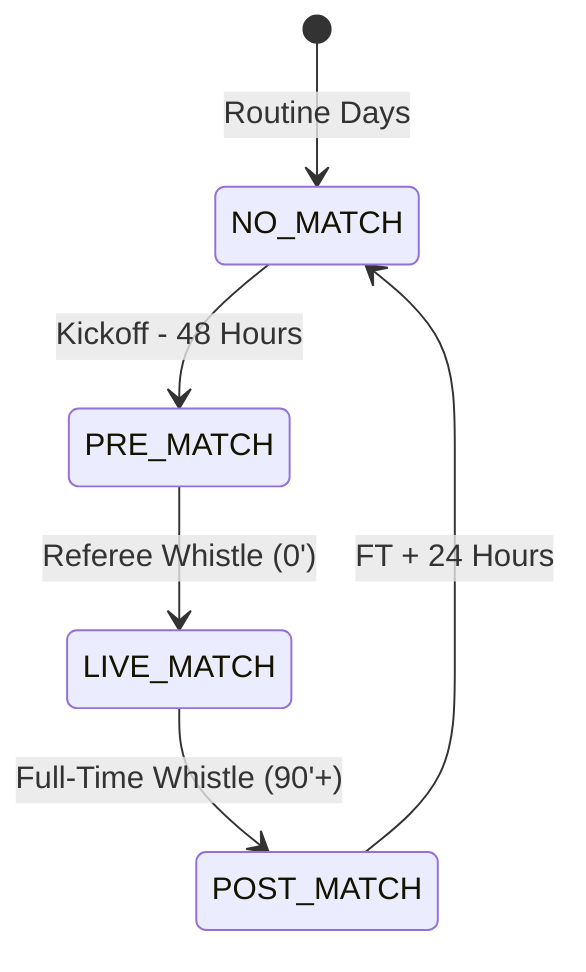

# 09 — DYNAMIC HOMEPAGE ENGINE

**Document Ref:** TC-DOC-09-DYNAMIC-HOME  
**System:** The 4-State Football Context Machine  
**Architectural Authority:** Level 2 Dynamic State Specification  

---

## 1. The 4 Operational Match States

The Champion homepage dynamically selects its visual hierarchy based on Manchester United's live match calendar:

---

## 2. State-Driven Hierarchy & Section Compositions

### State 1: `PRE_MATCH` (Kickoff - 48 Hours to Kickoff)
- **Supporter Intent:** "When is the game? Who are we playing? Who is injured or starting?"
- **Section Sequencing:**
  1. `HERO_PREVIEW`: Big-screen countdown clock, opponent crest, venue (Old Trafford / Away), official broadcast channel (Vidio / Premier League).
  2. `TEAM_NEWS_LINEUPS`: Confirmed starting XI and bench (hydrated exactly at Kickoff - 60m).
  3. `HEAD_TO_HEAD`: Historical encounters, recent form guide (last 5 games).
  4. `MATCH_PREVIEW_ANALYSIS`: AI-synthesized tactical preview digest in Indonesian.
  5. `STANDINGS_WIDGET`: Current Premier League table context before kickoff.

### State 2: `LIVE_MATCH` (Kickoff to Full-Time + 15 Minutes)
- **Supporter Intent:** "What is the score? What minute is it? Who just scored or got carded?"
- **Section Sequencing:**
  1. `HERO_MATCH_LIVE`: Pulsing live match clock, real-time scoreline, current period (`1H`, `HT`, `2H`).
  2. `LIVE_TIMELINE`: Chronological stream of match events (goals, VAR decisions, red/yellow cards, substitutions).
  3. `IN_GAME_STATS`: Live ball possession %, shots on target, xG (expected goals) comparison.
  4. `LIVE_TABLE_TRACKER`: Real-time Premier League table simulating live points.

### State 3: `POST_MATCH` (Full-Time to FT + 24 Hours)
- **Supporter Intent:** "We won/lost! Where are the highlights, the goals, and the manager's post-match interview?"
- **Section Sequencing:**
  1. `HERO_RESULT`: Final scoreline, goalscorers with match minutes, Player of the Match badge.
  2. `WATCH_AGAIN`: Embedded official YouTube highlight video (auto-linked).
  3. `MATCH_REPORT`: AI-synthesized post-match tactical report in Indonesian.
  4. `POST_MATCH_REACTIONS`: Quotes from the manager and key players.
  5. `UPDATED_STANDINGS`: Confirmed post-match Premier League table standings.

### State 4: `NO_MATCH` (Routine Midweek / International Break)
- **Supporter Intent:** "What is the latest club news, transfer rumours, and injury updates?"
- **Section Sequencing:**
  1. `HERO_EDITORIAL`: Top trending club news story or confirmed transfer announcement.
  2. `TRANSFER_HUB`: Filterable transfer intelligence grid (distinguishing "CONFIRMED" from "RUMOUR").
  3. `NEXT_FIXTURE_TEASER`: Compact upcoming match countdown card.
  4. `WATCH_AGAIN`: Curated classic matches and training highlights.
  5. `CLUB_NEWS_FEED`: Chronological feed of verified club digests.

---

## 3. Transition Conditions & Fallback Behavior

- **Dynamic Transitions:** Evaluated on every request via `MatchContextEvaluator` or cached for 15s during live matches.
- **Graceful Fallback:** If upstream sports feeds become unresponsive during a live match, the system maintains the `LIVE_MATCH` state, locks the last verified score, and displays an amber "Live Update Stalled" badge rather than crashing to `NO_MATCH`.