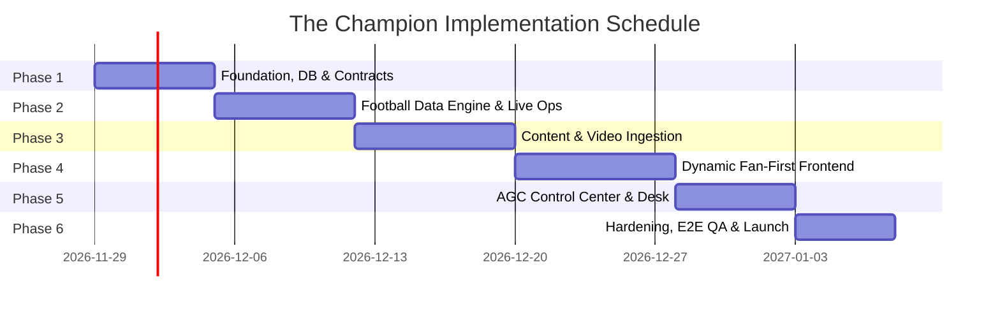

# 11 — IMPLEMENTATION ROADMAP & MILESTONES

**Document Ref:** TC-DOC-11-ROADMAP  
**System:** Phased Delivery Schedule & Definitions of Done  
**Architectural Authority:** Level 2 Execution Blueprint  

---

## 1. Six-Stage Phased Roadmap

---

## 2. Milestone Deliverables & Definitions of Done

### Milestone 1: Platform Foundation, DB Schema & API Contracts
- **Deliverables:** PostgreSQL 16 migrations (`05-DATABASE-SCHEMA.md`), Redis 7 BullMQ setup, Fastify API boilerplate, shared TypeScript interfaces.
- **Definition of Done:** Database schema deployed; sample synthetic jobs pushed and processed through BullMQ; zero unhandled errors on startup.

### Milestone 2: Football Data Engine & Authoritative Synchronization
- **Deliverables:** Sportmonks / API-Football connector, fixture hydrator, live score poller, standings calculator, match state machine.
- **Definition of Done:** Ingestion worker consumes mock live match stream; deterministically updates score and clock in < 3 seconds; zero LLM calls executed.

### Milestone 3: Source Gateway, Extraction & 11-Stage Content Pipeline
- **Deliverables:** RSS/HTML extractors, Gemini 1.5 Flash enrichment prompt harness, MinHash & pgvector deduplicator, YouTube playlist poller.
- **Definition of Done:** 50 test news articles transformed into structured Indonesian briefs; duplicates clustered; YouTube highlights matched to fixtures.

### Milestone 4: Dynamic Fan-First Frontend
- **Deliverables:** Next.js 15 App Router scaffolding, 4-state dynamic homepage engine, Live Match Center widget, Tailwind CSS tokens.
- **Definition of Done:** Frontend dynamically alternates across `PRE_MATCH`, `LIVE_MATCH`, `POST_MATCH`, and `NO_MATCH`; Lighthouse Performance score $\ge 90$.

### Milestone 5: AGC Control Center & Moderation Desk
- **Deliverables:** Operational dashboard, source registry UI, review desk with side-by-side verification, pipeline queue telemetry.
- **Definition of Done:** Operator can approve, edit, or reject pending items; approved edits immediately invalidate edge caches.

### Milestone 6: Hardening, Security & Launch Readiness
- **Deliverables:** k6 load testing (5,000 concurrent VUs), security audit, copyright compliance check, dead-letter recovery verification.
- **Definition of Done:** P99 latency < 100ms; zero unauthorized streaming links; zero memory leaks in background workers.